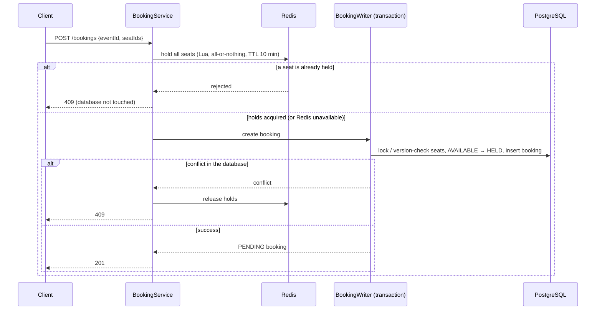

# SeatLock

[](https://github.com/emirkabacali/seatlock/actions/workflows/ci.yml)


[](LICENSE)

SeatLock is an event ticket booking REST API built with Spring Boot. Its core goal is simple
to state and hard to get right:

**A seat must never be sold twice, even under heavy concurrent traffic.**

Ticket sales are a classic concurrency problem: when thousands of users try to buy the same
seats at the same moment, a naive implementation will happily sell one seat to several people.
SeatLock reproduces that bug in a test, then fixes it — and proves the fix with concurrent
integration tests against real PostgreSQL and Redis.

> This is a portfolio/learning project. It runs locally and in CI; it is not deployed anywhere,
> and payments are simulated.

## Highlights

- **Concurrency-safe booking** with optimistic (`@Version`) and pessimistic (`SELECT ... FOR UPDATE`)
  locking, compared side by side against a deliberately naive strategy
- **Redis seat holds** with TTL as a fast first gate in front of the database (atomic Lua script)
- **Automatic hold expiry** via a scheduled job using `FOR UPDATE SKIP LOCKED`
- **Idempotent payments** with an `Idempotency-Key` header and database-level double-charge protection
- **JWT authentication** with role-based access (`USER` / `ADMIN`), BCrypt password hashing
- **Consistent errors** in RFC 9457 problem detail format, OpenAPI / Swagger UI
- **108 tests**: Mockito unit tests and Testcontainers integration tests, run on every push by GitHub Actions
- **One-command stack**: `docker compose up` builds and starts the app, PostgreSQL and Redis

## Architecture

```mermaid
flowchart LR
    client([Client]) -->|HTTP + JWT| api

    subgraph app [Spring Boot application]
        api[Controllers<br/>DTOs + validation] --> svc[Services<br/>business rules]
        svc --> repo[Repositories<br/>Spring Data JPA]
        job[[BookingExpiryJob<br/>@Scheduled]] --> svc
    end

    svc -->|seat holds, TTL| redis[(Redis)]
    repo -->|locking, constraints| pg[(PostgreSQL<br/>Flyway migrations)]
```

The code follows a layered structure: `controller` → `service` → `repository` → `entity`,
with `dto`, `exception`, `config` and `security` packages. Entities are never exposed; every
request and response is a DTO record.

### Booking flow



A booking is `PENDING` until it is paid (`CONFIRMED`, seats `BOOKED`), cancelled (`CANCELLED`)
or its hold runs out (`EXPIRED`); in the last two cases its seats become `AVAILABLE` again.

## How double booking is prevented

Booking a seat is a *check-then-act* operation: read the seat, check that it is `AVAILABLE`,
mark it `HELD`. If two requests run this at the same time, both can pass the check before
either writes, and both believe they got the seat.

SeatLock implements three strategies side by side (`SeatReserver`) so the difference can be
measured:

| Strategy | How it works | Outcome under contention |
|----------|--------------|--------------------------|
| `NAIVE` (demo only) | Read, check, then a bulk `UPDATE` that ignores the version column | **Double booking** |
| `OPTIMISTIC` (default) | `@Version` column; Hibernate updates with `WHERE id = ? AND version = ?`. A stale version updates 0 rows and the transaction fails | One winner, others fail fast with `409` |
| `PESSIMISTIC` | `SELECT ... FOR UPDATE` locks the seat rows (in id order to avoid deadlocks); other transactions wait, then see `HELD` | One winner, others wait and then get `409` |

`BookingConcurrencyIntegrationTest` releases 30 threads at the same moment (`CountDownLatch`)
against the same seat on a real PostgreSQL. A typical run:

```text
NAIVE        10 successful bookings for the same seat
OPTIMISTIC    1 success, 29 conflicts
PESSIMISTIC   1 success, 29 conflicts
```

With `NAIVE`, the number of "winners" matches the connection pool size: every transaction that
reaches the database before the first commit sees the seat as available. Further tests cover
overlapping multi-seat requests (`{1,2}`, `{2,3}`, … — no seat ever ends up in two bookings)
and the same race over HTTP (exactly one `201`, all others `409`).

**Trade-offs.** Optimistic locking holds no database locks and rejects losers immediately,
which suits short transactions and moderate contention. Pessimistic locking serializes access
to hot rows, which avoids wasted work under heavy contention but holds row locks and database
connections while others wait. The strategy is configurable via `BOOKING_LOCKING_STRATEGY`.

### Seat holds in Redis

Before the database step, a booking request tries to hold all requested seats in Redis
(`SeatHoldService`): one key per seat, owned by a random hold token, expiring after the hold
duration (10 minutes by default). A Lua script makes this all-or-nothing and atomic. If any
seat is already held, the request is rejected with `409` **without opening a database
transaction**, which keeps load off PostgreSQL when many users hit the same seats.

Redis is an optimization, not the source of truth:

- If the database step fails, the Redis holds are released again.
- Cancelling a booking releases its holds immediately (only keys owned by its token).
- If Redis is unreachable, booking falls back to database locking only (correct, but each
  request waits for the Redis timeout of 2 s first).

### Hold expiry

Redis forgets expired holds by itself, but the database must be updated too. A scheduled job
(`BookingExpiryJob`, every 30 s) marks overdue `PENDING` bookings as `EXPIRED` and releases
their seats. It selects bookings with `FOR UPDATE SKIP LOCKED`, so rows that are being changed
by another transaction — or by the same job on another application instance — are skipped
instead of waited for. Between the end of a hold and the next job run (≤ 30 s), the seat is
still `HELD` in the database and new bookings for it get `409`.

### Idempotent payments

`POST /api/v1/bookings/{id}/pay` requires an `Idempotency-Key` header. A double-clicked button
or an automatic client retry must not charge twice:

- The booking row is locked (`SELECT ... FOR UPDATE`), so all attempts for one booking —
  including concurrent retries — run one after another.
- If the user already sent this key, the stored result is returned (same status and body) with
  `Idempotent-Replayed: true`, and nothing is charged.
- Reusing a key for a different request (other booking or payment method, detected via a
  SHA-256 request hash) returns `422`.
- A partial unique index (`UNIQUE (booking_id) WHERE status = 'SUCCEEDED'`) guarantees at the
  database level that a booking is never paid twice.

Payments are simulated (`SimulatedPaymentGateway`, similar to Stripe test cards):
`pm_card_declined` and `pm_card_insufficient_funds` fail, any other payment method succeeds.
A failed payment leaves the booking `PENDING`, so the user can retry with a new key until the
hold expires. `PaymentConcurrencyIntegrationTest` sends 10 simultaneous requests with the same
key (one payment row, identical responses) and with different keys (exactly one success, nine
`409`s).

## Tech stack

| Area           | Technology                                                    |
|----------------|---------------------------------------------------------------|
| Language       | Java 17                                                       |
| Framework      | Spring Boot 4 (Web MVC, Data JPA, Validation, Security)       |
| Database       | PostgreSQL 17, Flyway migrations (`ddl-auto: validate`)       |
| Cache / holds  | Redis 7                                                       |
| Security       | Spring Security OAuth2 Resource Server (JWT, HS256), BCrypt   |
| Testing        | JUnit 5, Mockito, AssertJ, Spring Boot Test, Testcontainers   |
| Infrastructure | Docker (multi-stage build), Docker Compose, GitHub Actions    |
| Docs           | springdoc-openapi (Swagger UI)                                |

## Getting started

**Prerequisites:** Docker. For local development without the app container also Java 17.

### Run everything with Docker Compose

```bash
cp .env.example .env      # then set JWT_SECRET (at least 32 bytes), e.g. openssl rand -base64 48
docker compose up -d --build
curl http://localhost:8080/actuator/health
```

This builds the application image and starts it together with PostgreSQL and Redis. Swagger
UI is available at `http://localhost:8080/swagger-ui.html`. If `ADMIN_EMAIL` and
`ADMIN_PASSWORD` are set in `.env`, an admin account is created on first startup.

### Local development

```bash
cp .env.example .env               # set JWT_SECRET
docker compose up -d postgres redis
./mvnw spring-boot:run             # Windows: .\mvnw.cmd spring-boot:run
```

The application imports `.env` on startup (`spring.config.import`); real environment variables
take precedence. It refuses to start without a valid `JWT_SECRET`.

### Configuration

| Variable | Default | Purpose |
|----------|---------|---------|
| `JWT_SECRET` | — (required) | HMAC key for signing tokens, at least 32 bytes |
| `JWT_TTL` | `PT1H` | Access token lifetime |
| `ADMIN_EMAIL` / `ADMIN_PASSWORD` | — | Optional admin account created on startup |
| `DB_URL` / `DB_USERNAME` / `DB_PASSWORD` | local Compose database | PostgreSQL connection |
| `REDIS_HOST` / `REDIS_PORT` | `localhost` / `6379` | Redis connection |
| `BOOKING_HOLD_DURATION` | `PT10M` | How long seats stay held before payment |
| `BOOKING_LOCKING_STRATEGY` | `OPTIMISTIC` | `OPTIMISTIC` or `PESSIMISTIC` (`NAIVE` is unsafe, demo only) |
| `BOOKING_EXPIRY_INTERVAL` | `PT30S` | How often expired holds are cleaned up |

## API

Interactive documentation: `http://localhost:8080/swagger-ui.html`.

### Authentication

Stateless JWT bearer tokens (HS256, 1 hour by default). Public registration creates `USER`
accounts; `ADMIN` accounts come from configuration.

```bash
curl -X POST http://localhost:8080/api/v1/auth/register \
  -H 'Content-Type: application/json' -d '{"email":"jane@example.com","password":"secret-password"}'

curl -X POST http://localhost:8080/api/v1/auth/login \
  -H 'Content-Type: application/json' -d '{"email":"jane@example.com","password":"secret-password"}'
# → {"accessToken":"eyJ...","tokenType":"Bearer","expiresIn":3600}
```

| Access     | Endpoints                                                              |
|------------|------------------------------------------------------------------------|
| Public     | `POST /api/v1/auth/*`, all `GET` venue/event/seat endpoints, health, API docs |
| `ADMIN`    | Creating and changing venues, events and seat maps                     |
| Any user   | Bookings and payments (own bookings only)                              |

Missing or invalid tokens return `401`; insufficient roles return `403`; other users'
bookings return `404`.

### Endpoints

| Method | Endpoint                          | Description                                              |
|--------|-----------------------------------|----------------------------------------------------------|
| POST   | `/api/v1/auth/register`           | Create a `USER` account                                  |
| POST   | `/api/v1/auth/login`              | Obtain a JWT access token                                |
| GET    | `/api/v1/venues`                  | List venues (paginated: `page`, `size`, `sort`)          |
| GET    | `/api/v1/venues/{id}`             | Get a venue                                              |
| POST   | `/api/v1/venues`                  | Create a venue                                           |
| PUT    | `/api/v1/venues/{id}`             | Update a venue                                           |
| DELETE | `/api/v1/venues/{id}`             | Delete a venue (409 if it has events)                    |
| GET    | `/api/v1/events`                  | List events (paginated, optional `status` filter)        |
| GET    | `/api/v1/events/{id}`             | Get an event                                             |
| POST   | `/api/v1/events`                  | Create an event (starts as `DRAFT`)                      |
| PUT    | `/api/v1/events/{id}`             | Update an event                                          |
| PATCH  | `/api/v1/events/{id}/status`      | Change status (`DRAFT → ON_SALE → FINISHED`, or `CANCELLED`) |
| POST   | `/api/v1/events/{id}/seats`       | Generate the seat map of a `DRAFT` event (sections × rows × seats, max 10,000) |
| GET    | `/api/v1/events/{id}/seats`       | List seats, optional `status` filter                     |
| POST   | `/api/v1/bookings`                | Hold up to 10 seats of an `ON_SALE` event (`PENDING` booking) |
| GET    | `/api/v1/bookings/me`             | List the current user's bookings (paginated)             |
| GET    | `/api/v1/bookings/{id}`           | Get one of the current user's bookings                   |
| POST   | `/api/v1/bookings/{id}/pay`       | Pay for a `PENDING` booking (simulated, requires `Idempotency-Key`) |
| POST   | `/api/v1/bookings/{id}/cancel`    | Cancel a `PENDING` booking and release its seats         |

Errors use the [RFC 9457](https://www.rfc-editor.org/rfc/rfc9457) problem detail format.
Validation errors list every invalid field:

```json
{
  "type": "about:blank",
  "title": "Validation failed",
  "status": 400,
  "detail": "One or more fields are invalid",
  "instance": "/api/v1/venues",
  "errors": [{ "field": "name", "message": "must not be blank" }]
}
```

## Testing

```bash
./mvnw test     # Docker must be running
```

| Level | What | Examples |
|-------|------|----------|
| Unit | Business rules with mocked dependencies (Mockito), no Spring context | `BookingServiceTest`, `SeatServiceTest`, `EventStatusTest` |
| Integration | Full application context, MockMvc, real PostgreSQL and Redis via Testcontainers | `CatalogApiIntegrationTest`, `AuthSecurityIntegrationTest`, `PaymentApiIntegrationTest` |
| Concurrency | Many threads released at once with a `CountDownLatch`; results checked against the database | `BookingConcurrencyIntegrationTest`, `PaymentConcurrencyIntegrationTest` |

All integration test classes share one cached Spring context and one set of containers
(`AbstractIntegrationTest`). Security tests use real tokens from the login endpoint; other
tests use Spring Security's mocked JWTs. GitHub Actions runs the full suite and builds the
Docker image on every push and pull request.

## Limitations and possible next steps

- Payments are simulated; a real provider call would move out of the database transaction
  (pending record + provider-side idempotency key, or webhooks).
- Access tokens cannot be revoked before they expire (no refresh tokens or deny list).
- While Redis is down, every booking waits for the Redis timeout; a circuit breaker would avoid that.
- No rate limiting, metrics export or structured logging yet.

## License

This project is licensed under the [MIT License](LICENSE).
